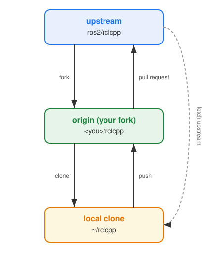

# ROS 2 Development Workflow

This explains how to contribute to the ROS 2 project, from `git` basics to build, test, CI, and review.

Reference:
- [ROS 2 Developer Guide](https://docs.ros.org/en/rolling/The-ROS2-Project/Contributing/Developer-Guide.html)
- [Contributing to ROS 2 Documentation](https://docs.ros.org/en/rolling/The-ROS2-Project/Contributing/Contributing-To-ROS-2-Documentation.html)

<!---
This session focuses on the practical development workflow, not on ROS 2 concepts.
The goal is that after this, an attendee can build ROS 2 from source, make a change,
run tests / CI, and open a well-formed PR that respects project policy.
--->

---


# Agenda

- General `git` workflow
- ROS 2 branches
- Repository checkout & full source build
- `colcon` build and tests
- Jenkins ROS 2 CI
- Issue / PR templates, QA & support
- AI-assisted contribution policy
- Contributing to ROS 2 documentation

<!---
We cover both contribution tracks: core libraries (C++/Python) and documentation.
--->

---

# Two Contribution Tracks

| | Core Libraries | Documentation |
| :-- | :-- | :-- |
| Where | [github.com/ros2](https://github.com/ros2) | [ros2/ros2_documentation](https://github.com/ros2/ros2_documentation) |
| Language | C++ / Python / CMake | reStructuredText / Markdown |
| Guide | [Developer Guide](https://docs.ros.org/en/rolling/The-ROS2-Project/Contributing/Developer-Guide.html) | [Contributing To Docs](https://docs.ros.org/en/rolling/The-ROS2-Project/Contributing/Contributing-To-ROS-2-Documentation.html) |
| Build | `colcon build` / `cmake` | `sphinx` / `make html` |

Both share the **same `git` / PR / DCO / review** workflow.

<!---
Emphasize: the collaboration mechanics are identical; only the toolchain differs.
--->

---

# General `git` Workflow — Fork & Clone



ROS 2 uses the **fork-and-pull-request** model on GitHub. Fork the target repository into your namespace, then clone. Keep `upstream` as the source of truth; `origin` is your fork.

```bash
# fork on GitHub UI first
git clone git@github.com:<you>/rclcpp.git
cd rclcpp
git remote add upstream git@github.com:ros2/rclcpp.git
git fetch upstream
```

<!---
Never push directly to ros2/*; always work through your own fork.
--->

---

# General `git` Workflow — Branch & Commit

Create a **topic branch** off the correct base branch (usually `rolling`).

```bash
git checkout -b fix/executor-deadlock upstream/rolling
```

Write focused commits, one logical change per commit. **Sign off every commit** — the [Developer Certificate of Origin (DCO)](https://developercertificate.org/) is mandatory.

```bash
git commit -s -m "Fix deadlock in MultiThreadedExecutor"
```

<!---
`-s` adds the "Signed-off-by:" trailer. PRs without DCO fail the DCO check.
--->

---

# General `git` Workflow — Pull Request Flow

1. Push the topic branch to your fork.
2. Open a PR against `ros2/<repo>` `rolling`.
3. Fill the PR template; link related issues.
4. Green **CI + DCO + at least one maintainer approval**.
5. Squash / rebase as requested, then a maintainer merges.

```text
you:fix/... ──PR──▶ ros2/repo:rolling ──(review + CI)──▶ merge
```

<!---
Rebase onto latest rolling before requesting review to avoid stale conflicts.
--->

---

# ROS 2 Branches — `rolling` is the trunk

**`rolling`** is the continuously developed development distribution. All new features and fixes land on `rolling` **first**. Named distribution branches are cut from `rolling` at release.

| Branch | Purpose |
| :-- | :-- |
| `rolling` | active development, target of most PRs |
| `lyrical` / `kilted` / `jazzy` / `humble` | released distributions (maintenance) |

<!---
Develop against rolling unless the fix is specific to an older released distro.
--->

---

# ROS 2 Branches — Backporting via Mergify

- Fixes needed on released distros are **backported** from `rolling`.
- Label the PR (e.g. `backport-jazzy`) so **Mergify** automates a cherry-pick PR.
- Backports must respect [REP 2000](https://ros.org/reps/rep-2000.html) API/ABI stability rules for released distros.

```bash
git cherry-pick -x <sha>   # -x records the source commit
```

<!---
Released distributions are API/ABI stable; only bug fixes, no breaking changes.
--->

---

# Repository Checkout — `vcstool` & `.repos`

- ROS 2 is **many repositories** orchestrated by a `.repos` file.
- Use [`vcstool`](https://github.com/dirk-thomas/vcstool) to import the whole source tree.

```bash
mkdir -p ~/ros2_ws/src && cd ~/ros2_ws
wget https://raw.githubusercontent.com/ros2/ros2/rolling/ros2.repos
vcs import src < ros2.repos
vcs pull src        # keep everything up to date
```

<!---
ros2.repos pins each repo/branch. This is how the build farm assembles a workspace.
--->

---

# Full Source Build — Dependencies

- Resolve system dependencies with **`rosdep`**.

```bash
sudo rosdep init && rosdep update
rosdep install --from-paths src --ignore-src -y \
  --rosdistro rolling
```

- Install build tools: `colcon`, `vcstool`, compilers, `python3-*` deps.
- See the [source install guide](https://docs.ros.org/en/rolling/Installation/Alternatives/Ubuntu-Development-Setup.html).

<!---
rosdep maps package.xml keys to apt/pip packages per platform.
--->

---

# `colcon` Build

- [`colcon`](https://colcon.readthedocs.io/) is the meta-build tool for ROS 2 workspaces.

```bash
colcon build --symlink-install \
  --cmake-args -DCMAKE_BUILD_TYPE=RelWithDebInfo
```

- Useful options:
  - `--packages-select` / `--packages-up-to` — build a subset.
  - `--symlink-install` — edit Python/resources without rebuilding.
  - `--event-handlers console_direct+` — stream build output.

<!---
Source install/setup.bash after build to overlay the workspace.
--->

---

# `colcon` Test

```bash
colcon test --packages-select rclcpp
colcon test-result --all --verbose
```

- Test frameworks in ROS 2:
  - **C++**: `gtest` / `gmock`
  - **Python**: `pytest`
  - **Launch/integration**: `launch_testing`
- Every behavioral change should ship with a **regression test**.

<!---
`colcon test` runs both unit tests and linters; test-result summarizes failures.
--->

---

# Code Style & Linters

- ROS 2 enforces style automatically via **`ament_lint`**.
  - C++: `ament_uncrustify`, `ament_cpplint`, `ament_cppcheck`
  - Python: `ament_flake8`, `ament_pep257`
  - `ament_copyright`, `ament_xmllint`
- Follow the [ROS 2 Code Style](https://docs.ros.org/en/rolling/The-ROS2-Project/Contributing/Code-Style-Language-Versions.html) (based on Google C++ Style with ROS additions).

```bash
ament_uncrustify --reformat src/rclcpp
```

<!---
Run linters locally; CI will reject style violations otherwise.
--->

---

# Jenkins ROS 2 CI — [ci.ros2.org](https://ci.ros2.org/)

- ROS 2 CI runs on a **Jenkins build farm** across platforms.
- Coverage: **Linux, Linux-aarch64, Windows, RHEL**.
- Nightly jobs build & test all of `rolling` from source.
- Per-PR jobs validate a change against the full stack before merge.

<!---
ci.ros2.org is the developer CI (source build). build.ros.org is the release farm
that produces binary debs for distributions.
--->

---

# Jenkins CI — Running a PR Job

- Maintainers trigger a CI run scoped to your PR packages.

```text
Test with --packages-above-and-dependencies rclcpp
Job: ci_launcher → Linux / Linux-aarch64 / Windows / RHEL
```

- The green/red result is posted back; **all targets must pass**.
- You can reproduce a target locally with the same `colcon` invocation.

<!---
Contributors usually ask a maintainer to "run CI" and paste the job links in the PR.
--->

---

# Issue Templates

- Repos ship issue templates under `.github/ISSUE_TEMPLATE/`.
- Provide a **minimal reproducible example**:
  - ROS 2 distro & OS, RMW implementation
  - Install method (binary / source)
  - Exact steps, expected vs. actual behavior
- Search existing issues first; discuss the approach **before** a large PR.

<!---
A reproducible report is far more actionable than "it doesn't work".
--->

---

# PR Template & Review

- Fill the PR template: **what changed, why, how tested**.
- Checklist typically covers: tests added, docs updated, DCO signed.
- Review expectations:
  - Respond to reviewer comments directly and technically.
  - Keep the PR focused; avoid unrelated churn.
  - Rebase, don't merge `rolling` into your branch repeatedly.

<!---
Maintainer time is scarce; a tight, well-described PR gets reviewed faster.
--->

---

# AI-Assisted Contribution Policy

[Guidelines for AI-Assisted Contributions in the ROS Project](https://discourse.openrobotics.org/t/guidelines-for-ai-assisted-contributions-in-the-ros-project/55903)

- You **may** use AI tools to build, explore, and understand software.
- Extends the [OSRF Policy on Generative Tools](https://github.com/openrobotics/osra-policies-and-procedures) with quality & behavioral rules.
- Core idea: **do not shift verification work onto maintainers.**

<!---
The policy is a framework, not a permanent ban — but it sets clear boundaries.
--->

---

# AI Policy — The Rules

- **Author Ownership**: you own and can defend every line; you sign the DCO. Don't use maintainers as an LLM validation service.
- **Zero-tolerance for hallucinations**: PRs with non-existent APIs / config keys are closed immediately.
- **Disclosure**: state clearly if an LLM generated structural code, tests, or docs.
- **No LLM-dump**: write a concise, human-authored PR description and review replies.

<!---
Repeat offenses can lead to being blocked from the org repositories.
--->

---

# AI Policy — Responsible Workflow

1. Confirm the issue is valid; discuss the approach on the thread first.
2. Run the code locally — it **compiles, lints, and passes tests**.
3. Read your own diff line-by-line; remove verbose AI comments and cruft.
4. Explain the change in plain technical language yourself.

> "Maintainers want to talk to you, the author — not to your chatbot."

<!---
This mirrors good engineering practice regardless of whether AI was used.
--->

---

# Contributing to ROS 2 Documentation

- Source lives in [ros2/ros2_documentation](https://github.com/ros2/ros2_documentation).
- Built with **Sphinx**; pages in **reStructuredText** or **Markdown**.
- Branch per distribution: `rolling`, `jazzy`, `humble` …
- Same fork → branch → **DCO-signed** commit → PR flow as code.

<!---
Docs use the identical collaboration workflow; only the build tooling differs.
--->

---

# Docs — Build & Preview Locally

```bash
git clone https://github.com/ros2/ros2_documentation.git
cd ros2_documentation
pip install -r requirements.txt
make html
# open build/html/index.html
```

- Preview locally before opening the PR.
- CI builds the site and runs link / style checks on your branch.

<!---
Always verify rendering and links locally to save review round-trips.
--->

---

# Docs — Dev Container

- [ros2/ros2_documentation](https://github.com/ros2/ros2_documentation) ships a **Dev Container** for a reproducible, zero-setup toolchain.
- Open in **VS Code → "Reopen in Container"** (or GitHub Codespaces); it provisions Python, Sphinx, and all `requirements.txt` deps automatically.
- Same `make html` build inside the container — no host pollution, identical to CI.

```jsonc
// .devcontainer/devcontainer.json (excerpt)
{
  "image": "mcr.microsoft.com/devcontainers/python:3",
  "postCreateCommand": "pip install -r requirements.txt"
}
```

<!---
The Dev Container removes "works on my machine" issues — the environment matches CI,
so contributors (including newcomers) can build and preview docs without local setup.
--->

---

# Docs — Test

Before opening the PR, run the same checks CI runs — locally or inside the Dev Container.

```bash
make test         # rst style / whitespace (doc8)
make lint         # reStructuredText linter (sphinx-lint)
make spellcheck   # spell check prose (codespell)
make linkcheck    # detect broken internal / external links
make test-tools   # python tooling tests (pytest)
```

- Add legitimately-flagged words to [`codespell_whitelist.txt`](https://github.com/ros2/ros2_documentation/blob/rolling/codespell_whitelist.txt), and custom corrections to `codespell_dictionary.txt` — then `make check-dictionaries` / `make sort-dictionaries`.
- Sphinx builds with `-W`, so **warnings are errors**; a clean local run ≈ a green CI run.

<!---
These targets come straight from the ros2_documentation Makefile. `make test` is doc8
(style/whitespace, e.g. no trailing whitespace), not an umbrella target — run each check.
Catching spelling, dead links, and style issues locally saves maintainer review time.
--->

---

# Summary — Getting Started Checklist

- [ ] Fork, clone, add `upstream`
- [ ] `vcs import` the source, `rosdep install` deps
- [ ] `colcon build` + `colcon test` green locally
- [ ] Topic branch, focused **DCO-signed** commits
- [ ] Fill issue/PR templates; disclose AI use
- [ ] Pass Jenkins CI on all platforms
- [ ] Engage reviewers as the author

<!---
If every box is checked, the PR is in great shape for review.
--->

---

# References

- [ROS 2 Developer Guide](https://docs.ros.org/en/rolling/The-ROS2-Project/Contributing/Developer-Guide.html)
- [Contributing To ROS 2 Documentation](https://docs.ros.org/en/rolling/The-ROS2-Project/Contributing/Contributing-To-ROS-2-Documentation.html)
- [Code Style and Language Versions](https://docs.ros.org/en/rolling/The-ROS2-Project/Contributing/Code-Style-Language-Versions.html)
- [ci.ros2.org](https://ci.ros2.org/) / [colcon](https://colcon.readthedocs.io/)
- [AI-Assisted Contributions Guidelines](https://discourse.openrobotics.org/t/guidelines-for-ai-assisted-contributions-in-the-ros-project/55903)

<!---
Thank you — questions welcome.
--->
