# ROS 2 Executor

Based on **[The Evolution of Execution Management in rclcpp](https://www.polymathrobotics.com/blog/execution-management-in-rclcpp)**
by *Skye Medeiros* (Polymath Robotics), May 2026.

<!---
Most ROS 2 users write rclcpp::spin(node) and never look inside. The executor is where your callbacks actually get scheduled, and it has historically been a silent bottleneck.
Lyrical Luth ships an executor that demonstrably outperforms the classic ones.
All figures and quotations in this deck come from the referenced blog post.
--->

---


# Agenda

- What an Executor is, and the moving parts
- The classic execution model
  - Single-threaded / Multi-threaded / Callback groups
- Where it breaks down
  - Polling overhead, serialized discovery
- The paradigm shift: `EventsExecutor`
- `EventsCBGExecutor` — closing the gaps
- Benchmarks, caveats, and what to use

<!---
Roughly: concepts -> classic design -> problems -> new design -> numbers -> guidance.
--->

---

# The Moving Parts, In Brief

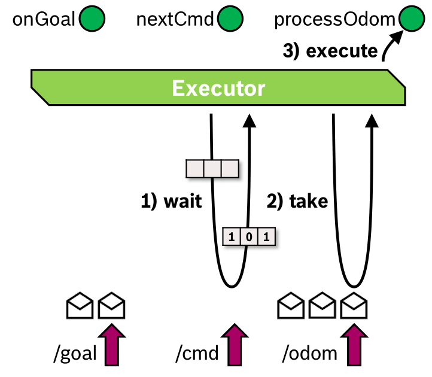

- Your node owns **entities**: subscriptions, service / action servers & clients, timers, waitables.
- Entities do **not** run themselves — something must notice they are ready and invoke the callback.
- That "something" is the **Executor**, living in the client library (`rclcpp` / `rclpy`), above `rcl` and `rmw`.

<!---
The layering matters for the rest of the talk: the executor sits in rclcpp, but the new design reaches down into rmw to get notified instead of asking. Entities are the unit of work.
--->

---

# Three Important Concepts

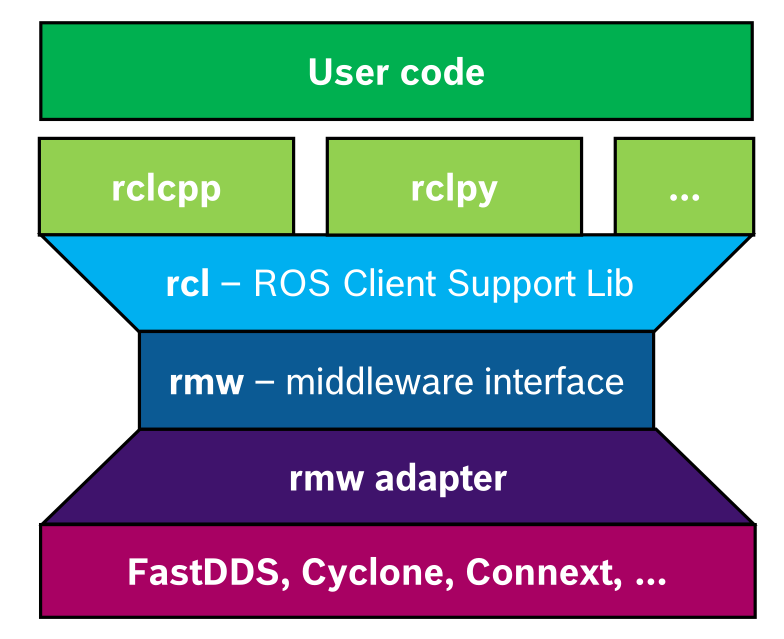

- **Executor** — owns the thread(s) that invoke callbacks. `spin()` is its main loop.
- **Callback Group** — the developer's declaration of *what is safe to run in parallel*.
- **Wait Set** — a flat collection of entities handed down to the middleware to wait on, rebuilt every iteration.

The wait set is the heart of the *classic* model — and the thing the new model deletes.

<!---
Foreshadow: wait set == polling. Callback groups == the concurrency contract.
--->

---

# The Classic Execution Model

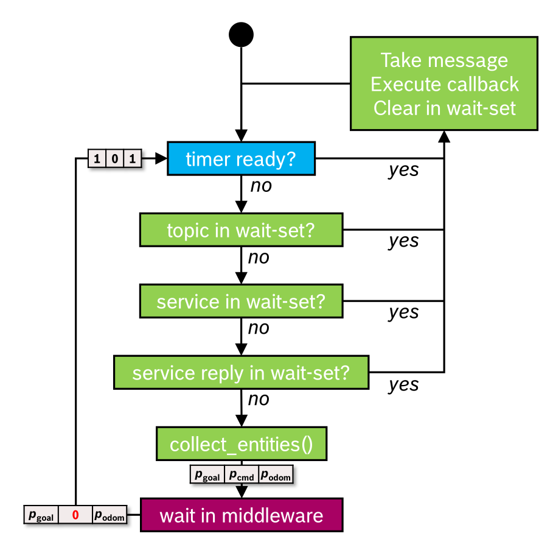

The loop is deliberately simple:

1. Build the **wait set** from all entities.
2. Ask the middleware: *who is ready?*
3. Pick one ready entity → run its callback.
4. Repeat.

Two halves: **discover work**, then **do work**.

<!---
This "poll, then service" shape is the root of both problems we will see later.
Note the discovery half is pure overhead - it produces no user-visible work.
--->

---

# `SingleThreadedExecutor`

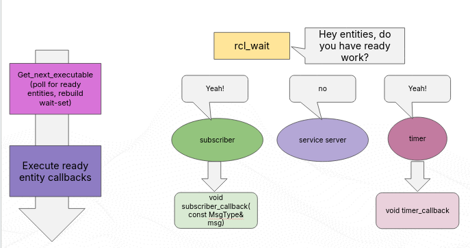

- What `rclcpp::spin(node)` gives you by default.
- **One thread**, one callback at a time, strictly sequential.
- Multiple nodes can share it — that is exactly what **component containers** do.

Simple, predictable, no data races between callbacks — and no parallelism at all.

<!---
Sequential execution is a feature, not only a limitation: it is the reason so much ROS callback code gets away with no locking. Composition into one process / one thread is the standard deployment pattern.
--->

---

# `MultiThreadedExecutor` + Callback Groups

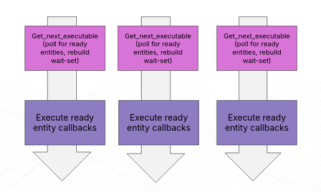

- Several **worker threads** pull ready callbacks from a shared pool.
- Concurrency is bounded by **callback groups**, so developers stay in control.

<!---
Callback groups were the answer to "how do we parallelize without breaking everyone's implicitly single-threaded callback code?" The contract is opt-in.
--->

---

# Callback Groups — the Concurrency Contract

| Type | Guarantee |
| :-- | :-- |
| **Mutually Exclusive** | At most **one** callback in the group runs at a time |
| **Reentrant** | Callbacks in the group may run **in parallel** with each other |
| *Separate groups* | Always free to run in parallel with one another |

Default: every entity lands in the node's default **mutually exclusive** group.

<!---
The default matters: many users swap in a MultiThreadedExecutor, change nothing else, and get zero parallelism because everything is still in one mutually exclusive group.
--->

---

# Polling Overhead

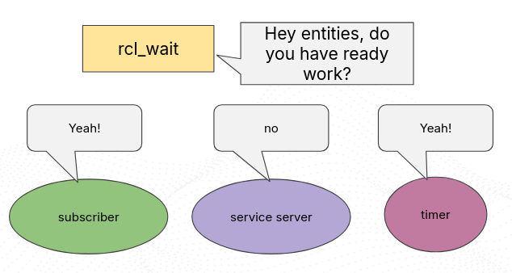

The executor asks **every** entity whether it is ready, on **every** iteration.

"The runtime cost of checking which entities are ready **scales linearly with the number of entities**."

One busy subscription among 49 idle ones costs the same to discover as 50 busy ones.

<!---
This is the "asking" cost. It is paid whether or not there is work to do, and it is paid by the same thread that would otherwise be running your callbacks.
--->

---

# It Gets Worse With Scale

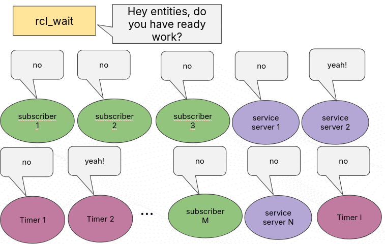

- Discovery cost grows with entity **count**, not with actual **traffic**.
- Real systems (Nav2, `rosbag2`, perception pipelines) have *many* entities per process.
- Especially painful on constrained hardware — ARM SBCs, where "the bottlenecks and resulting CPU contention become so much more apparent."

<!---
The composition story ("put all your nodes in one process") makes this worse, not better: composition increases the entity count per executor.
--->

---

# How Parallel, Actually?

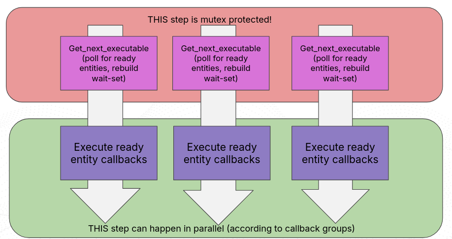

Every worker thread must take **`wait_mutex_`** before it can even look for work:

```cpp
{
  std::lock_guard wait_lock{wait_mutex_};
  // every worker thread serializes here!
  if (!get_next_executable(any_exec, timeout)) continue;
}
execute_any_executable(any_exec);   // only this runs in parallel
```

**The discovery half of the loop is still serial across all threads.**

<!---
So adding threads adds contention on the one step that was never parallelized. Past a point, more threads make throughput worse - which the benchmarks show dramatically.
--->

---

# `EventsExecutor`

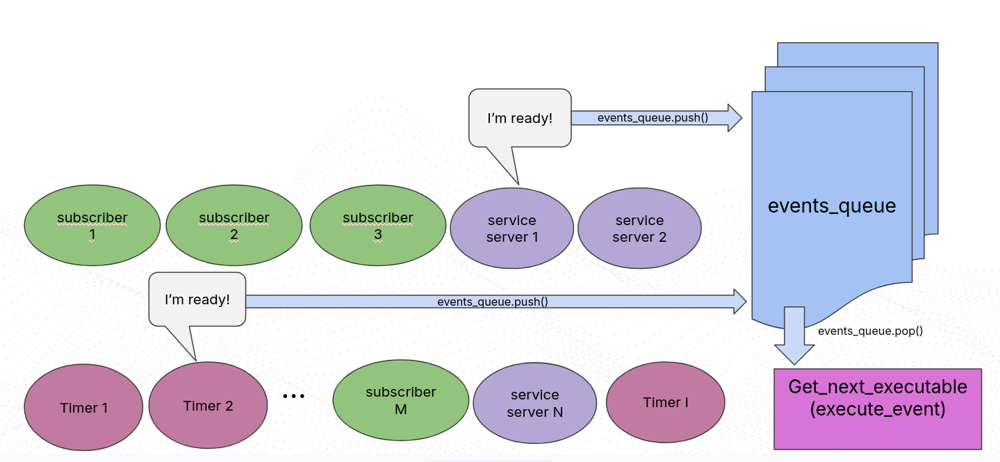


- Entities register an `rmw_event_callback_t` **at construction time**.
- The **middleware** signals readiness — message arrival, request, response, QoS event.
- Events are pushed onto a thread-safe **events queue**; the spin thread pops them **FIFO**.
- A dedicated **timer manager thread** enqueues timer events.

<!---
Push instead of pull. Discovery cost stops scaling with entity count and starts scaling with actual event volume - which is the work you wanted to pay for anyway.
--->

---

# `EventsExecutor` — Proven, but Incomplete

> "efficiently run a navigation stack consisting of many nodes in a single process, with minimal CPU contention and a reasonable memory footprint, **on a Raspberry Pi 4**."

**The gaps**

1. No **callback group** concurrency — a single thread services the queue.
2. No support for **simulated time**.
3. **Fast-firing timers** whose callbacks exceed the timer period overflow the queue faster than the spin thread can drain it.

<!---
Gap 2 alone disqualifies it for most simulation-driven development workflows.
Gap 3 is a stability problem, not just a performance one.
--->

---

# `EventsCBGExecutor`

- Keeps the **events queue**; feeds it into a callback-group-aware **`FIFOScheduler`** serviceable by **multiple threads**.
- Timer manager restructured: multiple **ROS time sources**, and an actively firing timer can no longer be serviced twice.
- The globally serialized "find work" step is **gone** — workers pull from the scheduler independently.

```cpp
sync_callback_groups();
auto ready = scheduler->get_next_ready_entity();   // no global lock
if (ready.moreEntitiesReady) scheduler->unblock_one_worker_thread();
ready.entity->execute_function();
```

<!---
Promoted out of experimental status by the Client Library WG for the **Lyrical Luth** feature freeze.
The key structural claim: events give you cheap discovery, the scheduler gives you real parallelism, and together they remove both bottlenecks at once - plus sim time support.
--->

---

# Benchmark

- Tool: `ros2-benchmark-container` on Lyrical testing images.
- Executors compared: `SingleThreaded`, `MultiThreaded`, `Events`, `EventsCBG` (1 and 8 threads).
- Topology: **50 topics, 63–2000 Hz, single process** → ~**60,000 msg/s** for 20 s ≈ **1.2 M payloads @ 1 MB**.
- Transports: **intra-process (`ipc_on`)** and **through the middleware** (Fast DDS, Cyclone DDS).
- QoS: `rclcpp` default — Reliable, Keep Last, Volatile, depth 10.
- Hardware: 8-core x86 Lenovo developer laptop; ~4 h per full suite.

Metrics: **throughput**, **mean end-to-end latency**, **CPU %**.

<!---
"Throughput" = message callbacks actually serviced within the window; latency = callback entry time minus message timestamp. This is a deliberately dense, stressful topology.
--->

---


---

- Only **intra-process** setups comfortably reach 1.2 M messages (~**100%** of expected).
- `EventsCBGExecutor` in **1-thread mode** services **as many or more** callbacks than the others, **at significantly lower latencies**, across every transport.
- The **denser** the workload, the bigger the gap.

<!---
Denser workload == more entities == more polling overhead removed. This is the cleanest demonstration of the "discovery is pure overhead" argument.
--->

---

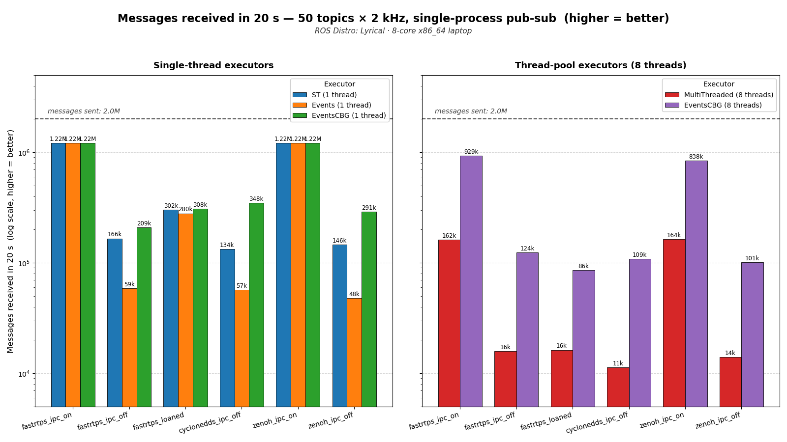

---

Using all available cores:

- Best multi-threaded result: **CBG + intra-process ≈ 75%** throughput — still *below* single-threaded.
- Through the middleware: **~10%** (CBG) vs. **<2%** (classic `MultiThreadedExecutor`).
- With Cyclone DDS, classic MT overhead was so severe that **4 of 50 subscribers received zero messages** in 20 s → **NaN** latency.

<!---
Read the last bullet slowly: not "slow", but complete starvation of entire subscriptions.
That is the wait_mutex_ contention from Problem 2, at scale.
--->

---

# CPU — Cost vs. Value


> "The callback group executor is spending about **1.3 to 1.75x more CPU** than the old polling-based multi-threaded one, but look at what it's getting for that extra spend — in the intraprocess cases, **up to 6x more throughput and 50x less latency!**"

The old executor's *lower* CPU number is not efficiency:

> "a symptom of **core starvation** because the scheduling is too slow."

<!---
Low CPU with low throughput means cores sat idle waiting on the lock. The events system
gives the CPU actual callback work to do instead of lock contention.
--->

---

# Caveats — None of This is Magic

- Gains scale with **entity count**. Few entities → little to win.
- The executor only removes **executor overhead**:

  > "None of the efficiency gains ... will help much if your **callbacks are the bottleneck**, or reduce the inherent overhead of your messages going through the **rmw layer**."

- **Unbounded queue risk**: if the CPU is overloaded, the events queue can grow without bound as it fails to keep up with the backlog — degrading latency for *everything* else.

<!---
Be honest about this in the talk: switching executors is not a substitute for fixing a
slow callback or an oversized message. The queue growth is a real failure mode.
--->

---

# How Many Threads Need?

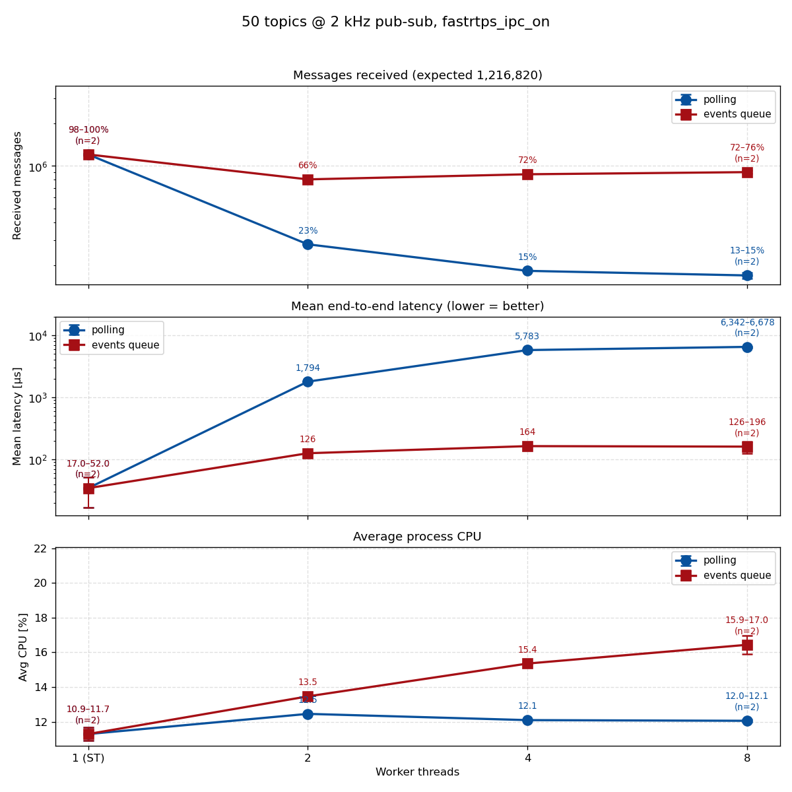


- Default to **single-threaded** for raw throughput.
- Reach for threads only for genuinely CPU-heavy callbacks — planning, machine vision, sensor processing.
- **Measure** the requirement; don't just pass `std::thread::hardware_concurrency()`.

<!---
The most immediately actionable slide: the reflex of "more threads = faster" is actively
harmful in most ROS 2 nodes, because context switching costs more than the callback.
--->

---

# Takeaways & References

- **Lyrical / Rolling**: `EventsCBGExecutor` available in `rclcpp` today.
- **Jazzy**: backported (June 2026 sync).
- Prefer **events over polling**; prefer **fewer threads**; declare **callback groups** deliberately; then **measure**.

References
- [The Evolution of Execution Management in rclcpp](https://www.polymathrobotics.com/blog/execution-management-in-rclcpp) — Skye Medeiros, Polymath Robotics
- [About Executors — ROS 2 Concepts](https://docs.ros.org/en/rolling/Concepts/Intermediate/About-Executors.html)
- [ros2/rclcpp](https://github.com/ros2/rclcpp) · [Client Library Working Group](https://github.com/ros2/rclcpp/wiki)

<!---
Thank you - questions welcome. All figures and quotations are from the Polymath Robotics blog post linked above.
--->
