# ROS 2 Executor

Based on **[The Evolution of Execution Management in rclcpp](https://www.polymathrobotics.com/blog/execution-management-in-rclcpp)**
by *Skye Medeiros* (Polymath Robotics), May 2026,

and **[The new executor on the block - is it any good?](https://docs.google.com/presentation/d/1mEgOQN7ZDcRBMYNp9aSNdAr60mE8R5Z9QlsUc8dpY4M/edit)**
by *Janosch Machowinski* (Cellumation) & *Skyler Medeiros* (Polymath Robotics).

<!---
Most ROS 2 users write rclcpp::spin(node) and never look inside. The executor is where your callbacks actually get scheduled, and it has historically been a silent bottleneck.
Lyrical Luth ships an executor that demonstrably outperforms the classic ones.
Figures and quotations in this deck come from the two referenced sources: the Polymath blog post, and the talk slides by the executor authors (Cellumation / Polymath).
--->

---


# Agenda

- What an Executor is, and the moving parts
- The classic execution model
  - Single-threaded / Multi-threaded / Callback groups
- Where it breaks down
  - Polling overhead, serialized discovery
- The paradigm shift: `EventsExecutor`
- `EventsCBGExecutor` — closing the gaps
- Benchmarks, caveats, and what to use

<!---
Roughly: concepts -> classic design -> problems -> new design -> numbers -> guidance.
--->

---

# The Moving Parts, In Brief

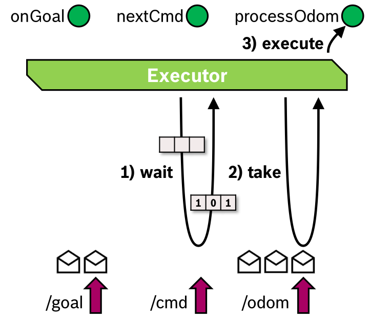

- Your node owns **entities**: subscriptions, service / action servers & clients, timers, waitables.
- Entities do **not** run themselves — something must notice they are ready and invoke the callback.
- That "something" is the **Executor**, living in the client library (`rclcpp` / `rclpy`), above `rcl` and `rmw`.

<!---
The layering matters for the rest of the talk: the executor sits in rclcpp, but the new design reaches down into rmw to get notified instead of asking. Entities are the unit of work.
--->

---

# Three Important Concepts

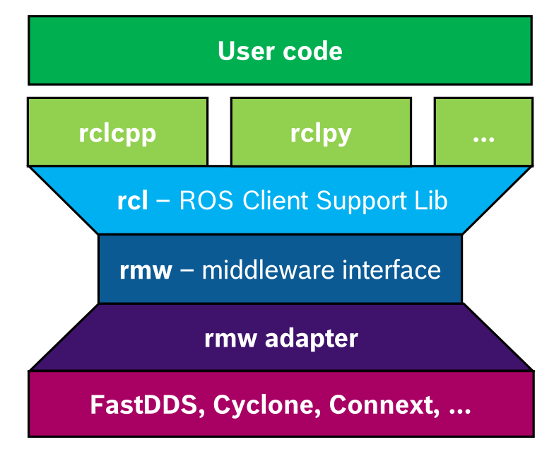

- **Executor** — owns the thread(s) that invoke callbacks. `spin()` is its main loop.
- **Callback Group** — the developer's declaration of *what is safe to run in parallel*.
- **Wait Set** — a flat collection of entities handed down to the middleware to wait on, rebuilt every iteration.

The wait set is the heart of the *classic* model — and the thing the new model deletes.

<!---
Foreshadow: wait set == polling. Callback groups == the concurrency contract.
--->

---

# The Classic Execution Model

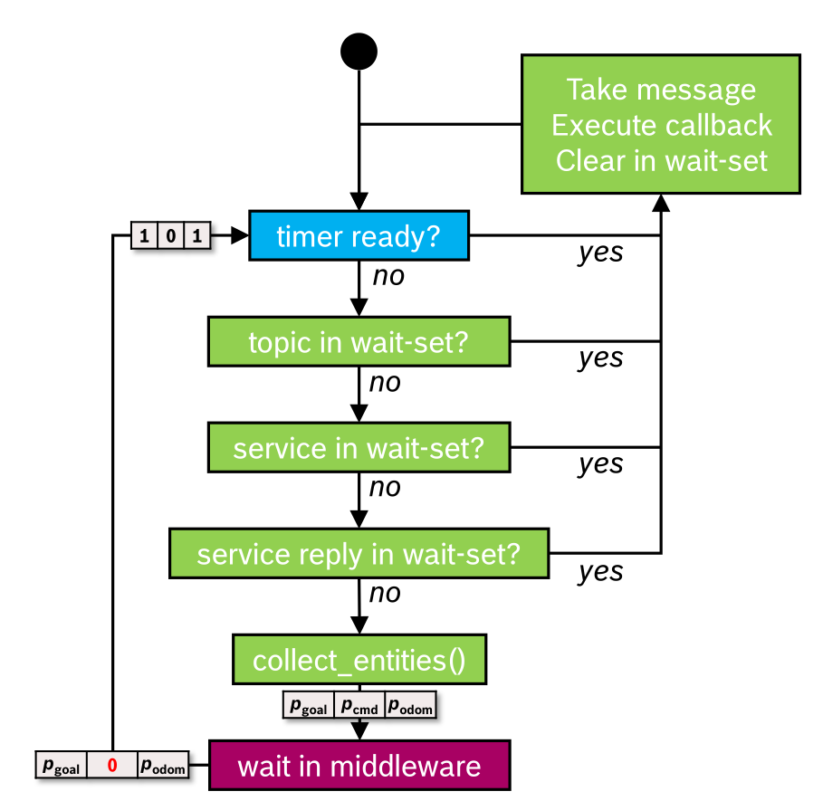

The loop is deliberately simple:

1. Build the **wait set** from all entities.
2. Ask the middleware: *who is ready?*
3. Pick one ready entity → run its callback.
4. Repeat.

Two halves: **discover work**, then **do work**.

<!---
This "poll, then service" shape is the root of both problems we will see later.
Note the discovery half is pure overhead - it produces no user-visible work.
--->

---

# `SingleThreadedExecutor`

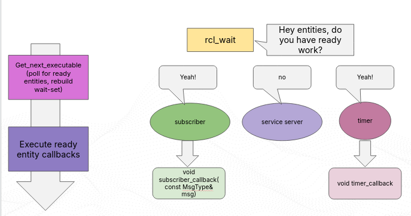

- What `rclcpp::spin(node)` gives you by default.
- **One thread**, one callback at a time, strictly sequential.
- Multiple nodes can share it — that is exactly what **component containers** do.

Simple, predictable, no data races between callbacks — and no parallelism at all.

<!---
Sequential execution is a feature, not only a limitation: it is the reason so much ROS callback code gets away with no locking. Composition into one process / one thread is the standard deployment pattern.
--->

---

# `MultiThreadedExecutor` + Callback Groups

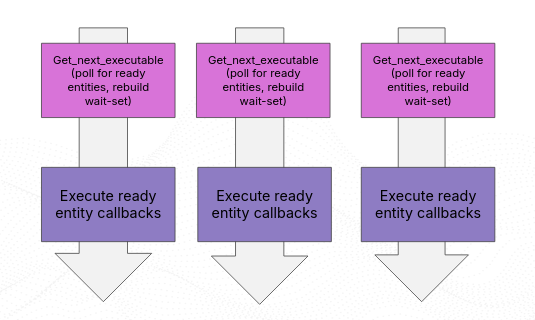

- Several **worker threads** pull ready callbacks from a shared pool.
- Concurrency is bounded by **callback groups**, so developers stay in control.

<!---
Callback groups were the answer to "how do we parallelize without breaking everyone's implicitly single-threaded callback code?" The contract is opt-in.
--->

---

# Callback Groups — the Concurrency Contract

| Type | Guarantee |
| :-- | :-- |
| **Mutually Exclusive** | At most **one** callback in the group runs at a time |
| **Reentrant** | Callbacks in the group may run **in parallel** with each other |
| *Separate groups* | Always free to run in parallel with one another |

Default: every entity lands in the node's default **mutually exclusive** group.

<!---
The default matters: many users swap in a MultiThreadedExecutor, change nothing else, and get zero parallelism because everything is still in one mutually exclusive group.
--->

---

# Polling Overhead

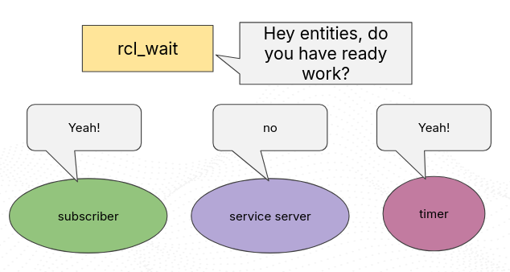

The executor asks **every** entity whether it is ready, on **every** iteration.

"The runtime cost of checking which entities are ready **scales linearly with the number of entities**."

One busy subscription among 49 idle ones costs the same to discover as 50 busy ones.

<!---
This is the "asking" cost. It is paid whether or not there is work to do, and it is paid by the same thread that would otherwise be running your callbacks.
--->

---

# It Gets Worse With Scale

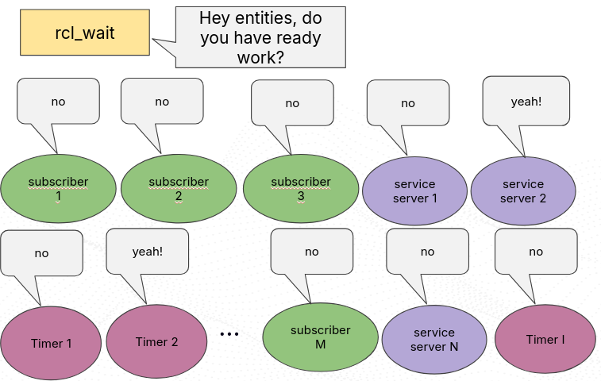

- Discovery cost grows with entity **count**, not with actual **traffic**.
- Real systems (Nav2, `rosbag2`, perception pipelines) have *many* entities per process.
- Especially painful on constrained hardware — ARM SBCs, where "the bottlenecks and resulting CPU contention become so much more apparent."

<!---
The composition story ("put all your nodes in one process") makes this worse, not better: composition increases the entity count per executor.
The Cellumation numbers are the "why a new executor?" slide from the authors' talk: this is not a theoretical problem, it was a production regression.
--->

---

# How Parallel, Actually?

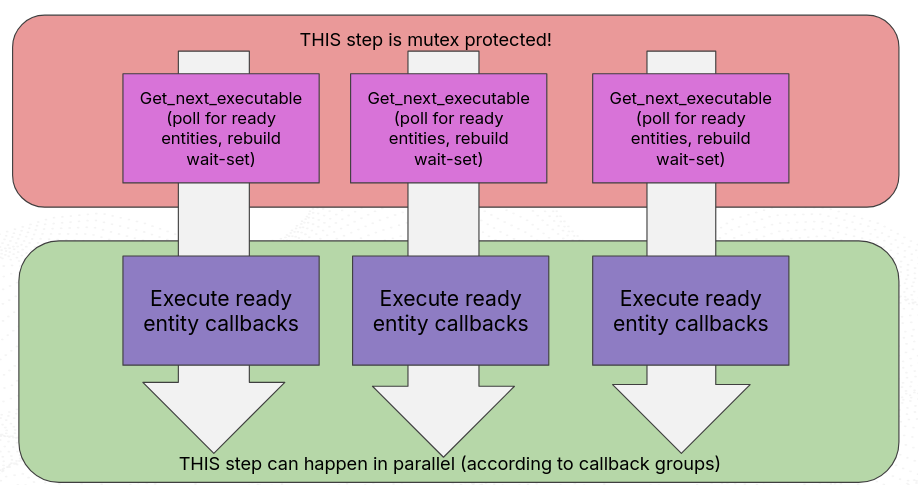

Every worker thread must take **`wait_mutex_`** before it can even look for work:

```cpp
{
  std::lock_guard wait_lock{wait_mutex_};
  // every worker thread serializes here!
  if (!get_next_executable(any_exec, timeout)) continue;
}
execute_any_executable(any_exec);   // only this runs in parallel
```

**The discovery half of the loop is still serial across all threads.**

<!---
So adding threads adds contention on the one step that was never parallelized. Past a point, more threads make throughput worse - which the benchmarks show dramatically.
--->

---

# `EventsExecutor`

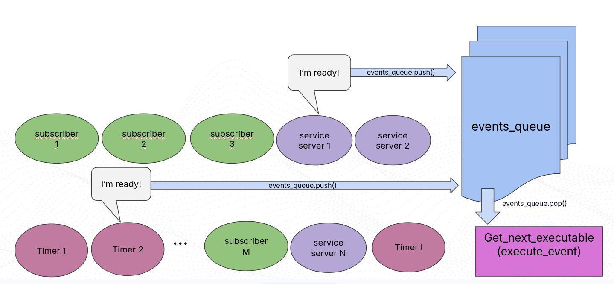


- Entities register an `rmw_event_callback_t` **at construction time**.
- The **middleware** signals readiness — message arrival, request, response, QoS event.
- Events are pushed onto a thread-safe **events queue**; the spin thread pops them **FIFO**.
- A dedicated **timer manager thread** enqueues timer events.

<!---
Push instead of pull. Discovery cost stops scaling with entity count and starts scaling with actual event volume - which is the work you wanted to pay for anyway.
--->

---

# `EventsExecutor` — Proven, but Incomplete

> "efficiently run a navigation stack consisting of many nodes in a single process, with minimal CPU contention and a reasonable memory footprint, **on a Raspberry Pi 4**."

**The gaps**

1. **Single-threaded only** — no callback group concurrency. Multi-threading was *mandatory* for Cellumation's application.
2. No support for **simulated time** in timers.
3. **Fast-firing timers** whose callbacks exceed the timer period overflow the queue faster than the spin thread can drain it.

<!---
Gap 1 is why the authors could not simply adopt EventsExecutor: "multi thread support is mandatory for our application".
Gap 2 alone disqualifies it for most simulation-driven development workflows.
Gap 3 is a stability problem, not just a performance one.
--->

---

# `EventsCBGExecutor`

- Keeps the **events queue** idea, but holds **one events queue per callback group**; a callback-group-aware **`FIFOScheduler`** serves **multiple threads**.
- Timer manager restructured: multiple **ROS time sources** (sim time works), and an actively firing timer can no longer be serviced twice.
- The globally serialized "find work" step is **gone** — workers pull from the scheduler independently, in **O(1)**.

```cpp
sync_callback_groups();
auto ready = scheduler->get_next_ready_entity();   // no global lock
if (ready.moreEntitiesReady) scheduler->unblock_one_worker_thread();
ready.entity->execute_function();
```

<!---
Promoted out of experimental status by the Client Library WG for the **Lyrical Luth** feature freeze.
The key structural claim: events give you cheap discovery, the scheduler gives you real parallelism, and together they remove both bottlenecks at once - plus sim time support.
Janosch's ROSCon 2024 talk has the full internals; the next slide is the short version.
--->

---

# Inside: Callback Group States

Every callback group is in exactly one of **three states**:

| State | Meaning |
| :-- | :-- |
| **Idle** | No pending events |
| **Busy** | A worker is executing one of its callbacks |
| **Needs Processing** | Events pending, no worker on it yet |

<!---
This is the whole trick. Readiness is tracked per *group*, not per entity, so the number of entities stops mattering. The group's own FIFO queue holds the events.
--->

---

# Inside: Two Lists, O(1) Dispatch

- Groups live in **two lists**: *Not Ready* (Idle / Busy) and *Ready* (Needs Processing).
- Events move a group from list to list; a newly ready group is pushed to the **back** of the Ready list.
- An event arriving on an **Idle** group **wakes one worker**.
- A worker takes the **first event of the first ready group** → **O(1)**, independent of entity count.
- Events inside a group are strictly **FIFO**.

Recent additions: **reentrant callback group** support, **worker queues**, **high-congestion optimizations**, **component container** integration.

<!---
"Cost goes from O(entities) to O(1)" is the single line to remember.
Reentrant support was contributed by Arman Hosseini; component container integration by Skyler Medeiros and Maurice.
--->

---

# Is It Stable? Where Can I Get It?

- A **non-mainline version ran in production for over 2 years** at Cellumation.
- Significant rewrite for mainline integration; the **mainline version has been in production since May 2026** — no issues so far in their use case.
- Backported in mainline `rclcpp` to **all distros except Humble**; tested extensively against **Jazzy and Kilted**.
- Humble has **no rmw events API**, so no events-based executors there.

<!---
"No Lyrical? No problem!" - if you are on Jazzy or Kilted, you can try it today after the sync.
Humble is a hard limit: the rmw layer has no on-ready callback hooks, so there is nothing for the executor to subscribe to.
--->

---

# How To Use It

- A **drop-in replacement** for `SingleThreadedExecutor` / `MultiThreadedExecutor`.
- **Defaults to multi-threaded**; pass `thread_num = 1` for single-threaded behaviour.
- Usable in **component containers**; `--isolated` gives one executor per node (Lyrical).

```cpp
rclcpp::executors::EventsCBGExecutor executor;   // multi-threaded by default
executor.add_node(node);
executor.spin();
```

<!---
Verify the exact constructor signature against the rclcpp version you ship with - the authors describe it as a drop-in, and the number-of-threads argument is the only knob most people need.
For composed systems, the point is that you don't have to rewrite nodes: switch the container's executor and the nodes come along.
--->

---

# Benchmark (1) — Polymath Blog

- Tool: `ros2-benchmark-container` on Lyrical testing images.
- Executors compared: `SingleThreaded`, `MultiThreaded`, `Events`, `EventsCBG` (1 and 8 threads).
- Topology: **50 topics, 63–2000 Hz, single process** → ~**60,000 msg/s** for 20 s ≈ **1.2 M payloads @ 1 MB**.
- Transports: **intra-process (`ipc_on`)** and **through the middleware** (Fast DDS, Cyclone DDS).
- QoS: `rclcpp` default — Reliable, Keep Last, Volatile, depth 10.
- Hardware: 8-core x86 Lenovo developer laptop; ~4 h per full suite.

Metrics: **throughput**, **mean end-to-end latency**, **CPU %**.

<!---
"Throughput" = message callbacks actually serviced within the window; latency = callback entry time minus message timestamp. This is a deliberately dense, stressful topology with large payloads.
--->

---

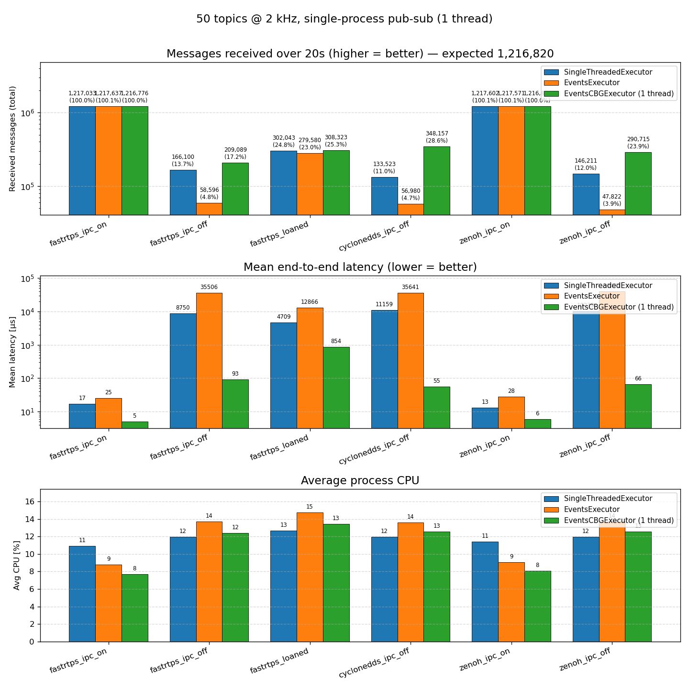

---

- Only **intra-process** setups comfortably reach 1.2 M messages (~**100%** of expected).
- `EventsCBGExecutor` in **1-thread mode** services **as many or more** callbacks than the others, **at significantly lower latencies**, across every transport.
- The **denser** the workload, the bigger the gap.

<!---
Denser workload == more entities == more polling overhead removed. This is the cleanest demonstration of the "discovery is pure overhead" argument.
--->

---

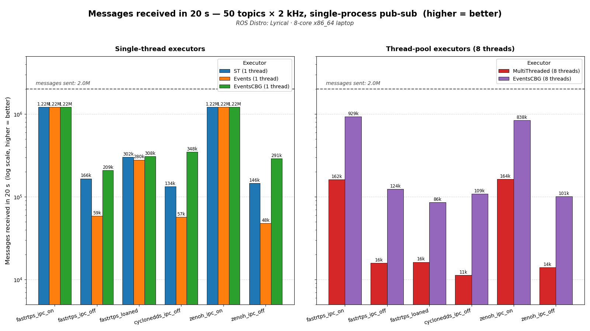

---

Using all available cores:

- Best multi-threaded result: **CBG + intra-process ≈ 75%** throughput — still *below* single-threaded.
- Through the middleware: **~10%** (CBG) vs. **<2%** (classic `MultiThreadedExecutor`).
- With Cyclone DDS, classic MT overhead was so severe that **4 of 50 subscribers received zero messages** in 20 s → **NaN** latency.

<!---
Read the last bullet slowly: not "slow", but complete starvation of entire subscriptions.
That is the wait_mutex_ contention from Problem 2, at scale.
--->

---

# CPU — Cost vs. Value


> "The callback group executor is spending about **1.3 to 1.75x more CPU** than the old polling-based multi-threaded one, but look at what it's getting for that extra spend — in the intraprocess cases, **up to 6x more throughput and 50x less latency!**"

The old executor's *lower* CPU number is not efficiency:

> "a symptom of **core starvation** because the scheduling is too slow."

<!---
Low CPU with low throughput means cores sat idle waiting on the lock. The events system
gives the CPU actual callback work to do instead of lock contention.
--->

---

# Benchmark (2) — The Authors' Talk

- Topology: **2 nodes, 2 processes** (1 publisher, 1 subscriber); latency / CPU measured on the **subscriber**.
- Middleware: **`rmw_zenoh`**, staggered publishers, **N subscriptions per callback group**.
- Payload: one `tf2_msgs/TFMessage` with a single transform — *small* messages, many of them.
- Executors: `SingleThreaded`, `MultiThreaded` (2 / 4 / 12), `EventsCBG` (1 / 2 / 4 / 12), `CallbackIsolated` (per group).
- Cutoff: latency rise or message drop.
- Hardware: Dell Latitude 5491, i7-8850H (6C / 12T), 16 GiB, Ubuntu 26.04, Rolling from source — "the oldest machine we could find".

<!---
Complementary to benchmark (1): small payloads, inter-process, a different rmw. If both setups agree, the conclusion is not an artifact of one topology.
RMW thread CPU load is removed from the following graphs - only the executor's own cost is shown.
--->

---

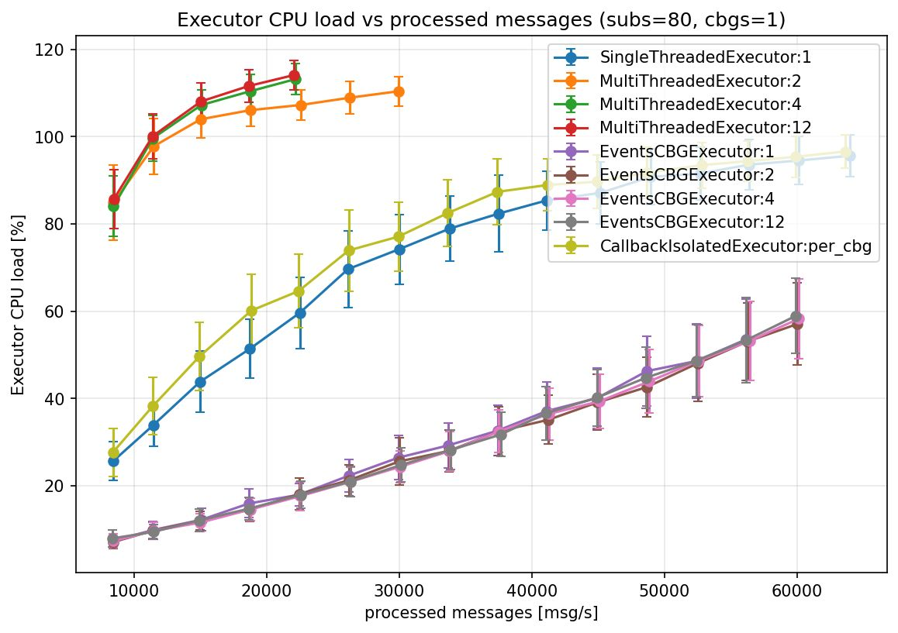

---

**80 subscriptions, one callback group** (single-threaded comparison):

- Classic `MultiThreaded` hits **>100% CPU** and reaches its cutoff at **~20–30k msg/s**.
- `SingleThreaded` climbs to **~95%** at 60k msg/s.
- `EventsCBG` with **1, 2, 4 or 12 threads** all sit on the **same line**: **~58%** at 60k msg/s.

<!---
Two things to see. First, the gap between the classic family and CBG. Second, that the four CBG curves are indistinguishable: thread count is almost free with this design.
--->

---

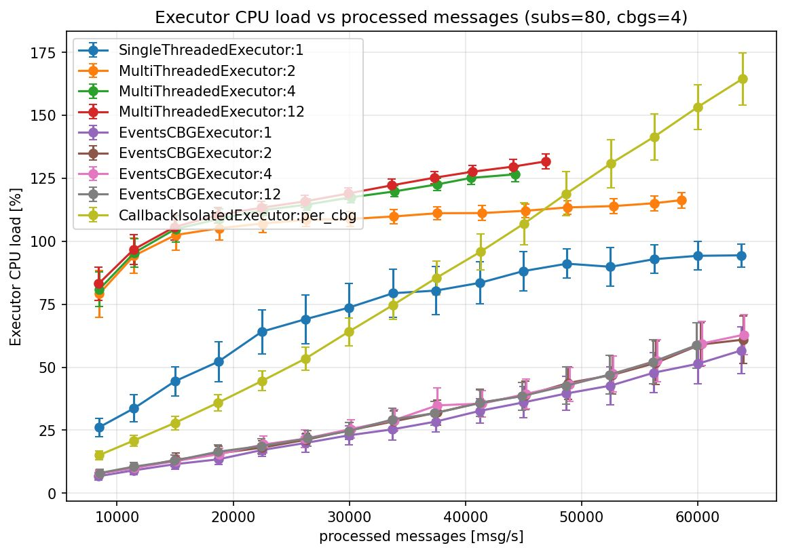

---

**80 subscriptions, four callback groups** (multi-threaded comparison):

- Classic `MultiThreaded`: **>80% CPU** already at 10k msg/s, cutoff around **45–60k msg/s**.
- `EventsCBG`: **~8%** at 10k msg/s, **~60%** at 64k msg/s — regardless of thread count.
- `CallbackIsolatedExecutor` (one executor per group) scales linearly but steeply.

<!---
The classic multi-threaded executor burns cores on the wait_mutex_ handoff; CBG does not.
CallbackIsolatedExecutor is the other new Lyrical executor - useful for isolation guarantees, not for efficiency.
--->

---

# Latency

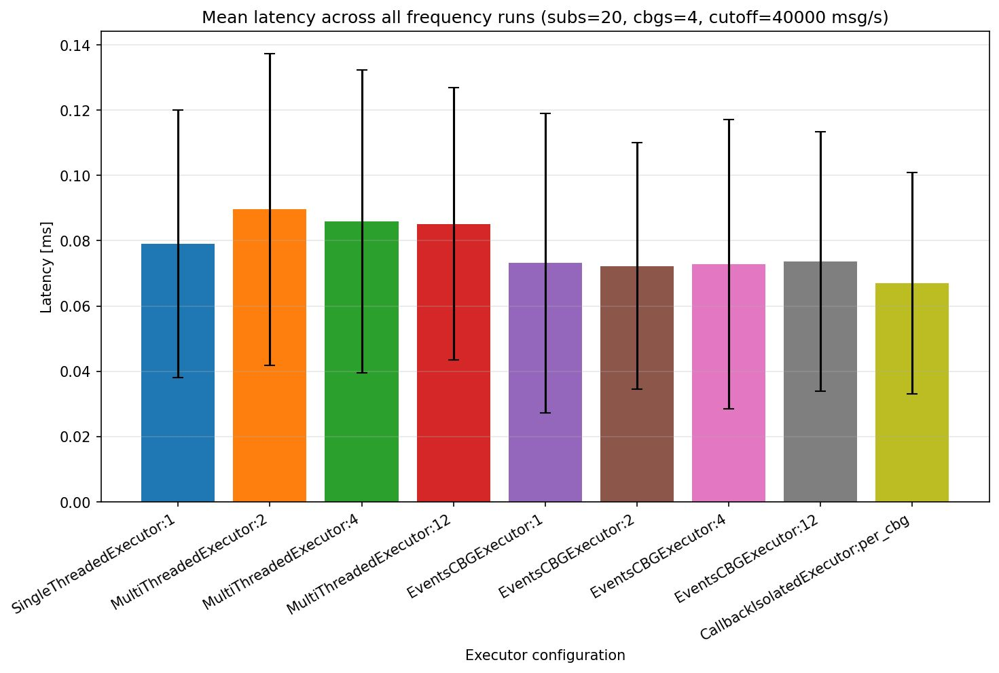

Mean latency, 20 subscriptions, 4 callback groups, up to 40k msg/s:

- `SingleThreaded` ≈ **0.08 ms**
- `MultiThreaded` ≈ **0.085–0.09 ms**
- `EventsCBG` ≈ **0.072–0.074 ms**, flat across 1–12 threads

With a single callback group, classic MT latency **doubles** (~0.17 ms) while CBG stays at ~0.07 ms.

<!---
Latency is the less dramatic metric here because messages are tiny and the rmw dominates. Still, CBG is both lower and more consistent, and does not degrade when you add threads.
--->

---

# What "Check For Ready Work" Costs in rviz

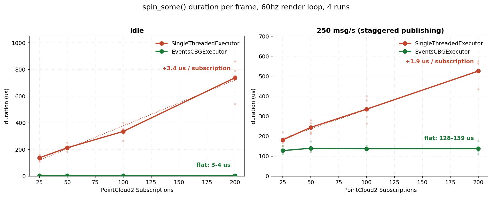

<!---
spin_some() duration per frame in rviz's 60 Hz render loop, with N PointCloud2 subscriptions.
Classic: +3.4 us per subscription when idle, +1.9 us per subscription at 250 msg/s - linear in entity count.
CBG: flat 3-4 us idle, flat 128-139 us under load, regardless of how many subscriptions exist.
This is the O(entities) -> O(1) claim, measured in a real application.
--->

---

# Real Applications: rviz

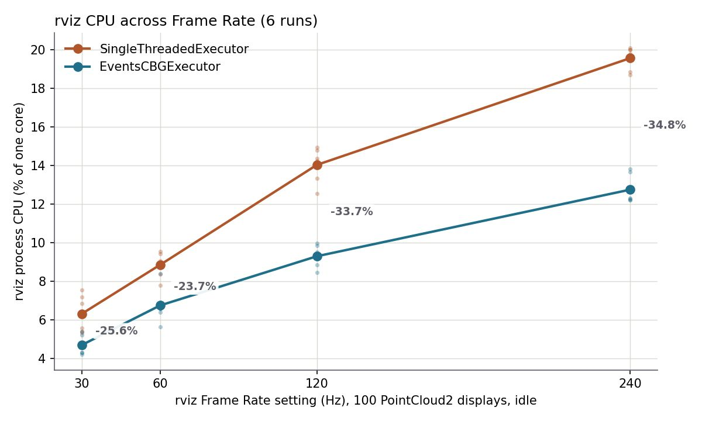

- **Idle** rviz with 100 PointCloud2 displays: **-25% to -35% CPU**, growing with frame rate.
- **Under load** (25 displays receiving 1000-point clouds at 10 Hz): roughly a wash (**+5% to -4%**).

<!---
A good honesty check: once the executor is no longer the bottleneck, the executor cannot help you. Idle rviz is dominated by polling, loaded rviz by deserialization and OpenGL.
--->

---

# Real Applications: `rosbag record -a`

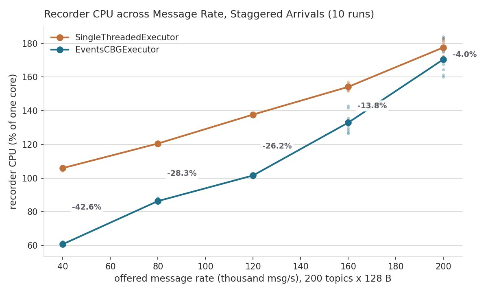

- 200 topics × 128 B, staggered arrivals.
- Recorder CPU: **-42.6%** at 40k msg/s, **-28%** at 80k, **-26%** at 120k, **-14%** at 160k, **-4%** at 200k.
- `-a` subscribes to *everything* — the classic executor paid polling cost on every one of those entities.

<!---
rosbag is the poster child: huge entity count, modest per-entity rate. The benefit shrinks as the rate rises and the work becomes serialization-bound - same lesson as rviz.
--->

---

# Caveats — None of This is Magic

- Gains scale with **entity count**. Few entities → little to win.
- The executor only removes **executor overhead**:

  > "None of the efficiency gains ... will help much if your **callbacks are the bottleneck**, or reduce the inherent overhead of your messages going through the **rmw layer**."

- **Unbounded queue risk**: if the process is **constantly CPU bound**, the internal event queue grows without bound — degrading latency for *everything* else. The authors have ideas to bound it, but it is not done yet.
- If your code **relies on the exact behaviour of the executor**, "you might have a problem anyway ;-)".

<!---
Be honest about this in the talk: switching executors is not a substitute for fixing a
slow callback or an oversized message. The queue growth is a real failure mode, and it is explicitly on the authors' "when NOT to use it" list.
--->

---

# Pitfalls When Switching

- **Custom waitables** MUST correctly implement:
  - `set_on_ready_callback`
  - `clear_on_ready_callback`
  - `take_data_by_entity_id`
- **Executor polymorphism**: don't call `spin_until_future_complete` through a base-class `rclcpp::Executor` pointer or reference.
- **Different event ordering**: strictly **FIFO**, no more type-based ordering (e.g. timers first). "99% of the users will not notice this."

<!---
The waitable one bites library authors (e.g. action servers, message filters, custom sync policies): a waitable without the on-ready callback hooks will simply never be noticed by an events executor.
--->

---

# How Many Threads Need?

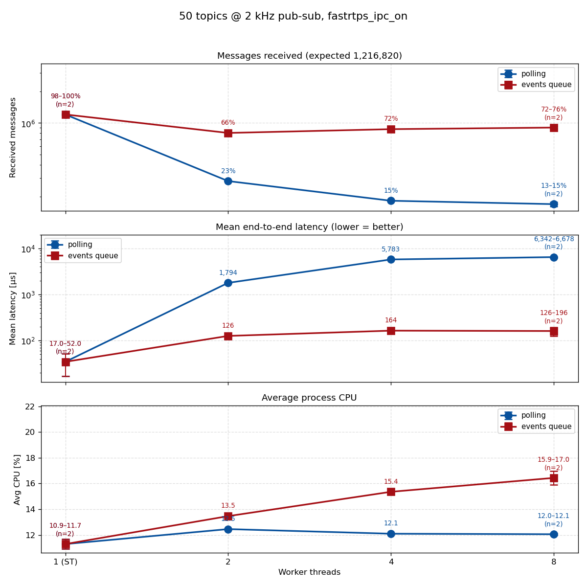

- With `EventsCBGExecutor`, thread count is **almost free**: 1 / 2 / 4 / 12 threads cost the same CPU and latency in benchmark (2). The authors' advice: *"Use multiple threads, Luke!"* (the default).
- Benchmark (1), with **1 MB payloads** through one process, still favoured **single-threaded** for raw throughput.

<!---
Reconcile the two sources: the thread *penalty* belonged to the classic MT executor's lock handoff and to context switching under heavy payloads. With CBG the penalty largely disappears for small messages, so the default (multi-threaded) is a sane starting point. The remaining advice is unchanged: measure.
--->

---

# Takeaways & References

- **Lyrical / Rolling**: `EventsCBGExecutor` available in `rclcpp` today; **backported to Jazzy and Kilted** (not Humble — no rmw events API).
- Prefer **events over polling**; declare **callback groups** deliberately; then **measure**.
- **Future work** from the authors: bounding the event queue, a warning when it grows too big, moving the implementation to `rcl` to share it with `rclpy`.
- Want to contribute? The **ROS Client Library Working Group** meets every other Friday, 8 am PST (OSRF events calendar).

<!---
Thank you - questions welcome. Figures and quotations are from the Polymath Robotics blog post and the authors' talk slides linked above.
--->
